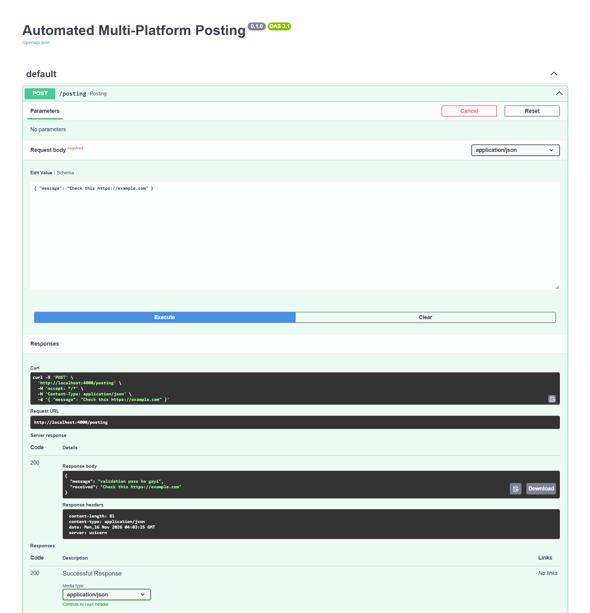
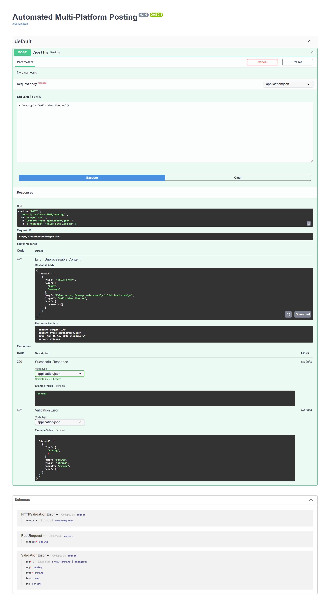
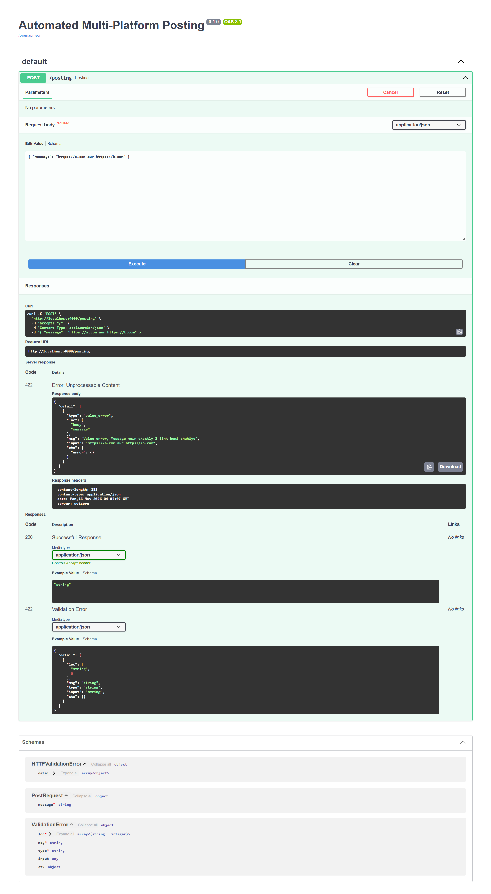
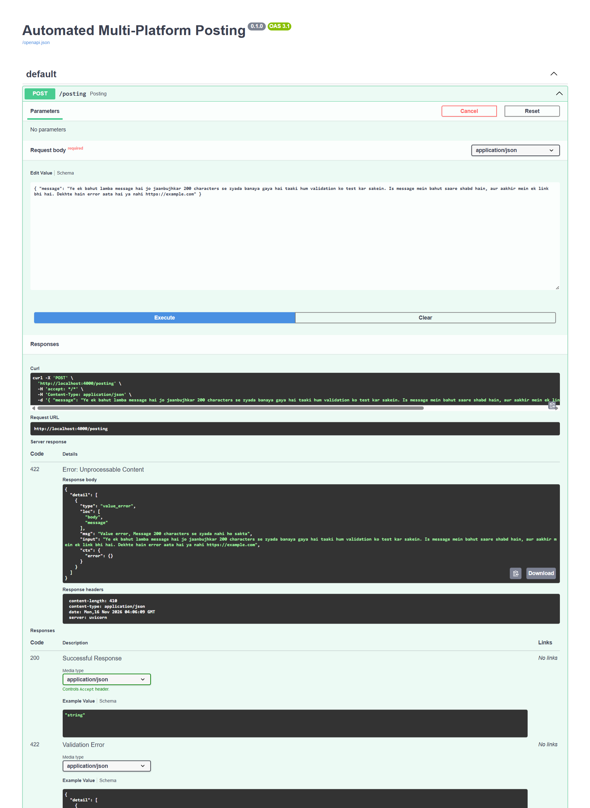
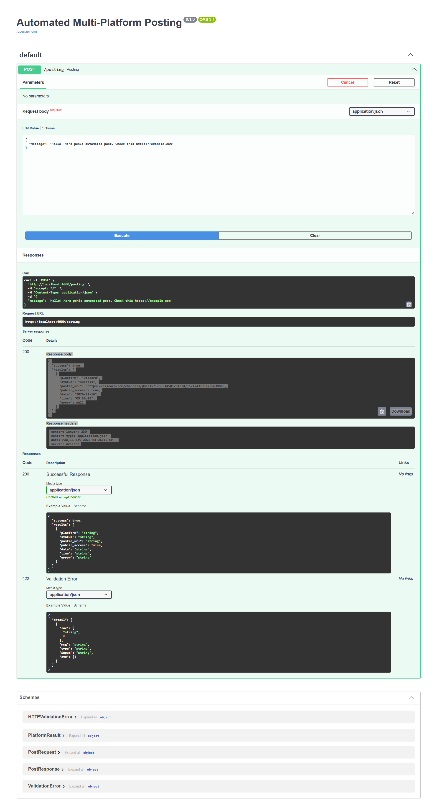
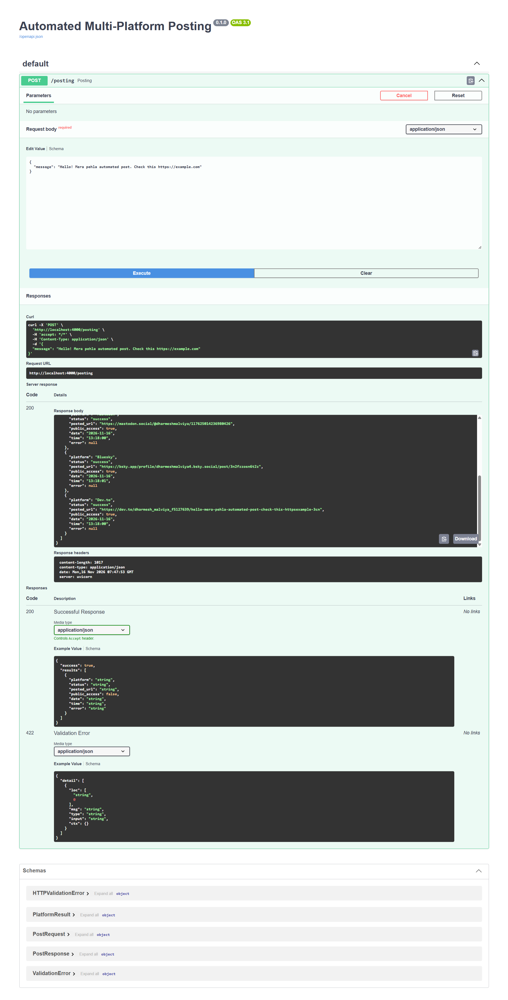

# Automated Multi-Platform Posting

A FastAPI application that validates a short message and publishes it to
5 third-party platforms in parallel: Discord, Telegram, Mastodon, Bluesky and Dev.to.
If one platform fails, the others still run.

## Features

- `POST /posting` endpoint (port 4000)
- Input validation: max 200 characters, exactly one valid CTA link
- Parallel posting with `asyncio.gather`
- Per-platform error handling (one failure never stops the rest)
- Credentials only through environment variables
- Automated tests (pytest)

## Platforms

| Platform | API used | Credentials needed |
|---|---|---|
| Discord | Incoming Webhook | `DISCORD_WEBHOOK_URL` |
| Telegram | Bot API (`sendMessage`) | `TELEGRAM_BOT_TOKEN`, `TELEGRAM_CHAT_ID` |
| Mastodon | `/api/v1/statuses` | `MASTODON_INSTANCE`, `MASTODON_TOKEN` |
| Bluesky | AT Protocol (`createSession`, `createRecord`) | `BLUESKY_HANDLE`, `BLUESKY_APP_PASSWORD` |
| Dev.to | Forem API (`/api/articles`) | `DEVTO_API_KEY` |

Note: Discord posts go to a private server channel, so `public_access` is `false` for Discord.

## Project structure

```text
automated-posting/
|-- app/
|   |-- main.py
|   |-- schemas.py
|   |-- config.py
|   |-- platforms/
|   |   |-- base.py
|   |   |-- discord.py
|   |   |-- telegram.py
|   |   |-- mastodon.py
|   |   |-- bluesky.py
|   |   `-- devto.py
|   `-- services/
|       `-- posting_service.py
|-- tests/
|   `-- test_posting.py
|-- .env.example
|-- requirements.txt
`-- README.md
```

## Setup

```bash
git clone https://github.com/Dharmeshh02/automated-posting.git
cd automated-posting
python -m venv venv
venv\Scripts\activate
pip install -r requirements.txt
```

Copy `.env.example` to `.env` and fill in your own credentials.

## Run

```bash
uvicorn app.main:app --host 0.0.0.0 --port 4000
```

Swagger docs: http://localhost:4000/docs

## Sample request

```bash
curl -X POST http://localhost:4000/posting \
  -H "Content-Type: application/json" \
  -d '{"message": "Check out our latest platform https://example.com"}'
```

## Sample response

```json
{
  "success": true,
  "results": [
    {
      "platform": "Telegram",
      "status": "success",
      "posted_url": "https://t.me/your_channel/17",
      "public_access": true,
      "date": "2026-11-16",
      "time": "13:18:01",
      "error": null
    },
    {
      "platform": "Mastodon",
      "status": "failed",
      "posted_url": null,
      "public_access": false,
      "date": null,
      "time": null,
      "error": "Mastodon error 401: ..."
    }
  ]
}
```

## Validation rules

| Case | Result |
|---|---|
| Empty message | 422 |
| More than 200 characters | 422 |
| No link or more than one link | 422 |
| Invalid URL | 422 |

## Tests

```bash
python -m pytest -v
```

## Screenshots

### Validation





### Posting


## Security

No credentials are committed. `.env` is in `.gitignore`; use `.env.example` as a template.

